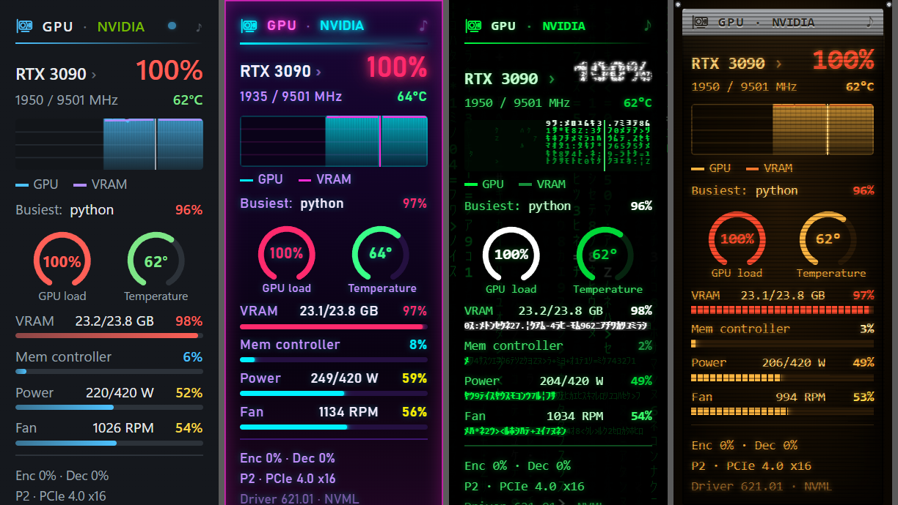
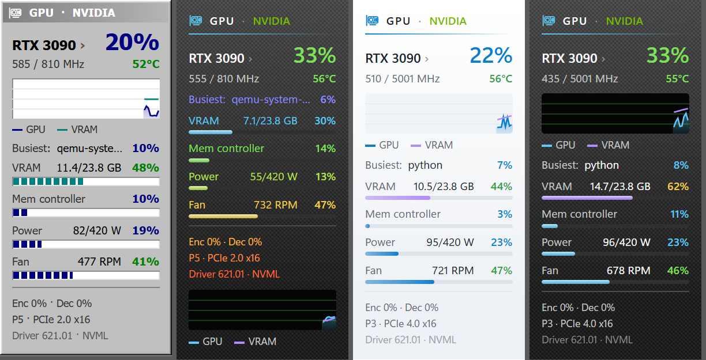
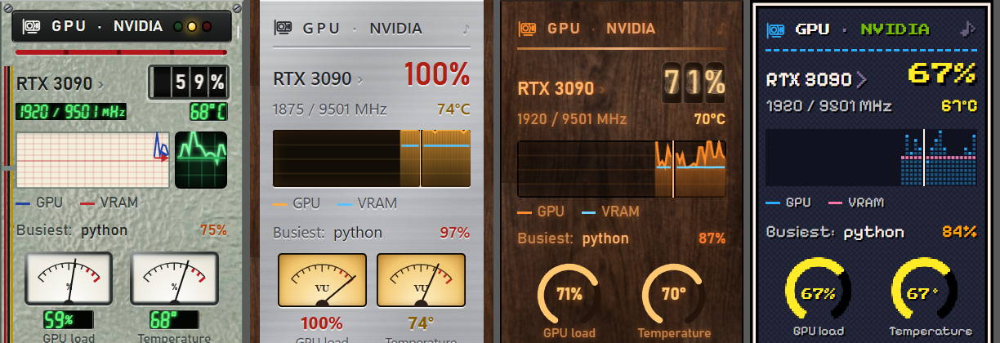
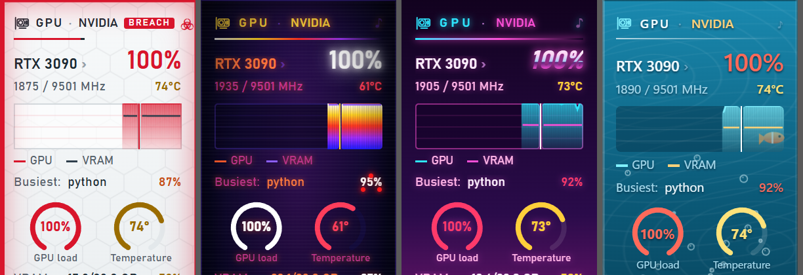
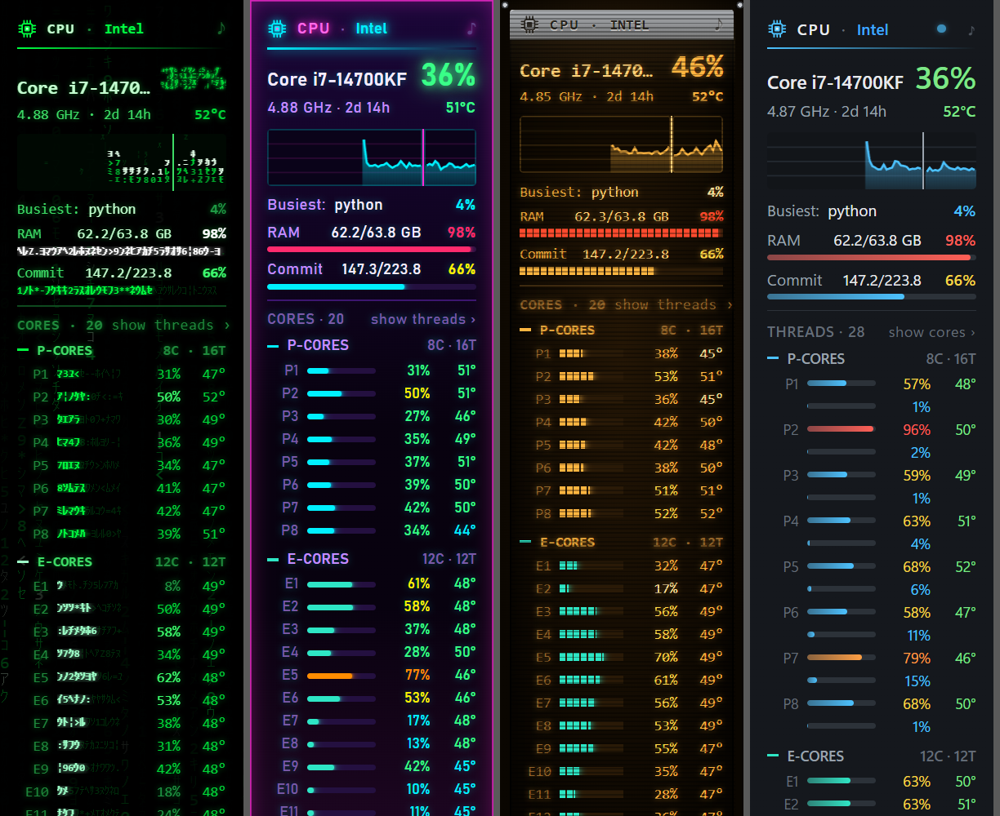

# Modern Meters

Desktop gadgets for Windows 10 and 11: **CPU, GPU, Network, Drives and Weather**, each in its own
small window on the desktop. No 8GadgetPack needed.

**[⬇ Download the latest version](https://github.com/livonianlabs/modern-meters-app-releases/releases/latest)**
· [Русский](#по-русски)

> **Beta (0.9).** Everything works, but it has been tried on few computers so far. If something
> looks wrong, please [open an issue](https://github.com/livonianlabs/modern-meters-app-releases/issues).

## What it shows

- **CPU:** total load and its graph, clock, uptime, memory, every core (P- and E-cores apart on
  hybrid Intel processors) or every thread, temperatures from Core Temp (fetched in two clicks if
  you don't have it). A click on *Busiest* lists the five busiest programs.
- **GPU:** load and temperature rings, video memory, memory controller, power, fan, clocks,
  encoder and decoder, PCIe link, the busiest programs. NVIDIA cards are read directly (NVML),
  the others through DirectX.
- **Network:** download and upload with a graph, Wi-Fi network and signal, addresses (hidden until
  clicked), firewall, link speed, ping, traffic per session and in total.
- **Drives:** each disk with its partitions, health, SSD life, temperature, read and write speed.
- **Weather:** now, the next hours as a chart, a rain radar map, rain in the next two hours, three
  days, sunrise and sunset, UV index and air quality, from [Open-Meteo](https://open-meteo.com/).

A **live zone** at the right of every graph shows the last seconds five times a second. **Alarms**
(the ♪ on a gadget's title) sound when the processor or graphics card overheats, video memory is
nearly full or the connection drops. If Windows' performance counters are broken, a gadget offers
to repair them.

## Styles

**Dark**, **Light** and **Auto** (as Windows is set); **Glass** and **Colored glass**, **Liquid** (a
thick slab of glass bending the wallpaper, with ripples under the mouse) and **Air**, all four
showing the wallpaper through, sharp or blurred as you like; **Carbon** and **Rainbow**; four
**terminals** (retro green, aubergine, monochrome, blue commander); **Digital rain**, where even
the graphs and numbers are made of falling glyphs; **Neon 77**; **Atompunk**; **Bunker**; **Gray 90s**;
and instruments and worlds: **Reactor** (a control desk with drum counters, a chart recorder, an
oscilloscope and an emergency stop), **Hi-Fi 70s**, **LCD**, **Glow tubes**, **Mission control**,
**Blueprint**, **E-paper**, **Chalkboard**, **8-bit**, **BIOS**, **Videotape**, **Synthwave**,
**Swarm**, **Biomech**, **Thermal vision**, **Psionic**, **Frontier**, **Biolab**, **Backup power**,
**Brass**, **Sonar**, **Aquarium**. 40 in all, each with a touch of its own (a cursor retyping the
title, needles swinging past and settling, eggs that hatch...) and easter eggs to find.

## Install

1. Download `ModernMeters-<version>-win-x64.zip` from the
   [latest release](https://github.com/livonianlabs/modern-meters-app-releases/releases/latest).
2. Unpack it into a folder of your choice, for example `Documents\Modern Meters`.
3. Run `ModernMeters.exe`. The first start lines the gadgets up along the right edge and asks
   whether to start with Windows.

Windows may say *"Windows protected your PC"*, as for any new program that isn't signed yet: click
**More info → Run anyway**.

Needs Windows 10 or 11 (64-bit) and the Microsoft Edge WebView2 Runtime, which comes with Windows 11
and current Windows 10. .NET is included.

## Using it

- **The tray icon** (by the clock; a left click brings the gadgets to the front, a right click opens
  the menu): which gadgets are open, line them up, style, accent color, glass transparency,
  language (13), always on top, animations, start with Windows.
- **Drag** a gadget by its title. **⚙** and **✕** appear when the mouse is over it: ⚙ for its own
  settings, ✕ to close it (and whether it should still open at the next start).
- **New versions:** once a day the app looks for one here. It shows as **↑ 0.9.2** on the gadgets'
  titles and in the tray menu; a click opens its page to download it.

## Privacy

Modern Meters collects nothing about you. It connects to: Open-Meteo (weather, for the place you
pick or the one Windows' location service gives), RainViewer and Esri (the radar map, only while it
shows), api.ipify.org (your external IP for the Network gadget, every 30 minutes), 1.1.1.1 (ping),
alcpu.com (Core Temp, only when you ask for it) and GitHub (the daily check for a new version). The
glass styles read your wallpaper to draw it; it stays on your computer. Settings stay in
`%LOCALAPPDATA%\ModernMeters\App`.

## Uninstall

Exit from the tray menu (untick *Start with Windows* first), then delete the app's folder and
`%LOCALAPPDATA%\ModernMeters\App`. If you turned on SSD life, run
`smart\install-disk-health.ps1 -Uninstall` as administrator first.

## Support

Modern Meters from here is free, all of it. If you like it, you can
[buy us a coffee on Ko-fi](https://ko-fi.com/silverenio) (also in the tray menu). Questions, ideas
or bugs: [open an issue](https://github.com/livonianlabs/modern-meters-app-releases/issues).

## For 8GadgetPack

The same gadgets for the Windows Sidebar (8GadgetPack) are free and open source:
[Modern Meters for 8GadgetPack](https://github.com/livonianlabs/modern-meters).

---

## По-русски

Гаджеты для рабочего стола Windows 10 и 11: **процессор, видеокарта, сеть, накопители и погода**,
каждый в своём окошке. 8GadgetPack не нужен. 17 стилей, у каждого своя фишка; плавная зона на
графиках; сигналы перегрева и обрыва связи; радар осадков; Core Temp в два клика.

**Установка:** скачай `ModernMeters-<версия>-win-x64.zip` из
[последнего выпуска](https://github.com/livonianlabs/modern-meters-app-releases/releases/latest),
распакуй в любую папку и запусти `ModernMeters.exe`. Если Windows скажет «Система Windows защитила
ваш компьютер», нажми **Подробнее → Выполнить в любом случае**: так бывает с любой новой
программой без подписи.

**Как пользоваться:** всё в меню значка у часов (правый клик): какие гаджеты открыты, «Выстроить
гаджеты», стиль, цвет акцента, прозрачность стекла, язык, «Поверх всех окон», анимации, автозапуск.
Гаджет перетаскивается за заголовок; ⚙ и ✕ появляются под мышью. Новая версия появляется в
заголовке как **↑ 0.9.2**; клик открывает её страницу.

**Поддержать:** программа отсюда бесплатна целиком. Если нравится, можно
[угостить нас кофе на Ko-fi](https://ko-fi.com/silverenio) (есть и в меню значка).

**Удаление:** выйди через меню (сначала сними «Запускать вместе с Windows»), удали папку программы
и `%LOCALAPPDATA%\ModernMeters\App`.

---

© 2026 Livonian Labs. Free to use. Windows, DirectX and Microsoft Edge are trademarks of Microsoft;
NVIDIA is a trademark of NVIDIA Corporation; Intel and AMD are trademarks of their owners.
